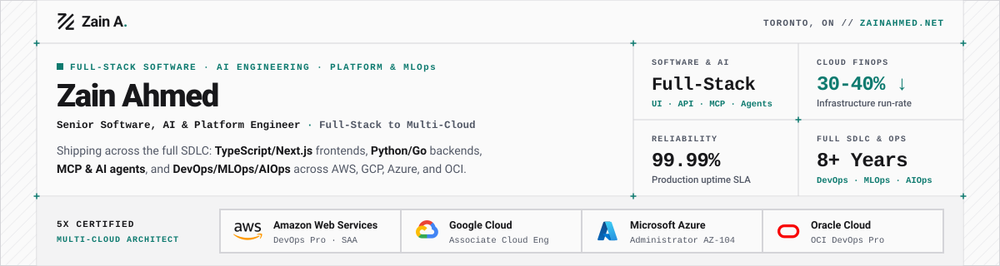

<p align="center">
  <a href="https://zainahmed.net">
    
  </a>
</p>

# Zain Ahmed

**[zainahmed.net](https://zainahmed.net)** · **[Engineering Blog](https://zainahmed.net/blog)** · **[Case Studies](https://zainahmed.net/projects)** · **[Certifications](https://zainahmed.net/certifications)** · **[LinkedIn](https://www.linkedin.com/in/thezainahmed)** · **[llms.txt](https://zainahmed.net/llms.txt)** · **[hello@zainahmed.net](mailto:hello@zainahmed.net)**

I am a software, AI, and platform engineer with over eight years of production experience. I build and operate systems across the full SDLC, from web applications and backend APIs to AI agent harnesses and hybrid infrastructure.

Good engineering pairs clear specifications and deterministic verification loops with operational ownership. I write TypeScript, Next.js, React, Python, Go, and Java for application services alongside Terraform, OpenTofu, Ansible, and Kubernetes manifests for the platform layer.

I run the open-source CNCF and Kubernetes stack on bare-metal Linux servers and across AWS, Google Cloud, Azure, and Oracle Cloud Infrastructure. My production environments hold a 99.99 percent availability SLA, cut cloud spend by 30 to 40 percent, and pass SOC 2, HIPAA, and PCI-DSS audits. I work from Toronto, Canada.

## Architecture and Stack

| Domain | Scope & Outcomes | Primary Technologies |
| :--- | :--- | :--- |
| **Full-Stack & Distributed Software** | Product UIs, REST and OpenAPI 3.1 contracts, generated SDKs, microservices, and sub-second web applications. | TypeScript, JavaScript, Next.js, React, Python, Go, Java, Node.js, PostgreSQL, Redis, SQL, Bash. |
| **AI Engineering & Agent Harnesses** | Model Context Protocol (MCP) servers, reusable agent skills, deterministic eval loops, RAG pipelines, and LLM routing. | MCP, Anthropic Claude, Google Gemini, Vertex AI, OpenAI, PyTorch, Vector Search, JSON-RPC 2.0. |
| **OSS Kubernetes, Bare-Metal & Cloud** | On-premises bare-metal Linux clusters, multi-cloud architecture, Internal Developer Platforms (IDPs), and declarative IaC. | Kubernetes, Linux, Cilium eBPF, Helm, KEDA, Backstage, Docker, GKE, EKS, AKS, AWS, GCP, Azure, OCI. |
| **DevSecOps, MLOps, AIOps & FinOps** | Full SDLC automation, 75% faster release cycles, model drift telemetry, FinOps unit economics, and zero-trust governance. | Terraform, OpenTofu, Bicep, Ansible, ArgoCD, GitHub Actions, Prometheus, Grafana, OpenTelemetry, Datadog, Entra ID. |

## Open Source and Production Systems

- **[zainahmed.net](https://zainahmed.net)** · Full-stack platform, OpenAPI 3.1 contract, FinOps calculator, and live HTTP MCP gateway (`Next.js 16`, `TypeScript`, `MCP`).
- **[ghostty-config](https://github.com/thezaynahmed/ghostty-config)** · Terminal architecture with Monaspace texture healing and 18 calibrated themes across 16 editors (`Ghostty`, `Zsh`, `Tmux`, `Bash`).
- **[zainahmed-agent-skills](https://github.com/thezaynahmed/zainahmed-agent-skills)** · Reusable MCP plugin and AI agent workflows for architecture blueprints and FinOps analysis (`MCP`, `JSON Schema`, `TypeScript`).
- **[zainahmed-go](https://github.com/thezaynahmed/zainahmed-go)** · Typed Go client SDK generated from the `zainahmed.net` OpenAPI 3.1 specification (`Go`, `OpenAPI 3.1`).
- **[nutriguard-clinical-ops](https://github.com/thezaynahmed/nutriguard-clinical-ops)** · Full-stack clinical MLOps platform with real-time model drift detection and Kubernetes manifests (`Python`, `Next.js`, `GKE`, `Docker`).
- **[team-boost](https://github.com/thezaynahmed/team-boost)** · Collaborative web application with Microsoft Entra ID authentication and Azure cloud deployment (`Next.js`, `TypeScript`, `Azure`).
- **[summitlms-azure-terraform](https://github.com/thezaynahmed/summitlms-azure-terraform)** · Zero-trust cloud infrastructure with VNet isolation and Key Vault managed identities (`Terraform`, `Azure`, `Docker`).

## Selected Writing

- **[Essential AI Coding Feedback Loops for TypeScript](https://zainahmed.net/blog/essential-ai-coding-feedback-loops-for-typescript)** · Static type gates and deterministic test harnesses for autonomous coding agents.
- **[When Coding Agents Outgrow Git: Anthropic Scion](https://zainahmed.net/blog/when-coding-agents-outgrow-git-anthropic-scion)** · Multi-agent orchestration boundaries and state isolation for parallel engineering workflows.
- **[Pod Disruption Budgets: The Floor Kubernetes Won't Let You Fall Below](https://zainahmed.net/blog/pod-disruption-budgets-the-floor-kubernetes-wont-let-you-fall-below)** · Node drains and eviction math during production cluster upgrades.
- **[SOC 2 Continuous Compliance Blueprint](https://zainahmed.net/blog/soc2-continuous-compliance-blueprint)** · Automated audit evidence and IAM least privilege across cloud and hybrid environments.
- **[Zero-Trust Identity Architecture on Azure](https://zainahmed.net/blog/zero-trust-identity-azure)** · Conditional Access policies and workload identity federation in Entra ID.

## Certifications

Five active credentials across four cloud providers. Select any link in the table to verify the credential with its issuing authority.

| Provider | Certification | Level | Credential ID | Active Window | Verification |
| :--- | :--- | :--- | :--- | :--- | :--- |
|  **AWS** | **AWS Certified DevOps Engineer** | Professional | `9906ccb7-1339-4eb9-b714-2c6cbcd56954` | 2025 – 2028 | [Credly ↗](https://www.credly.com/badges/9906ccb7-1339-4eb9-b714-2c6cbcd56954). |
|  **Oracle** | **OCI 2025 Certified DevOps Professional** | Professional | `066828C64B2A78` | 2025 – 2027 | [Oracle CertView ↗](https://catalog-education.oracle.com/pls/certview/sharebadge?id=066828C64B2A78C45B111478C769FE1F6C8AF57B654ACA771B72E7912DE0A57E). |
|  **AWS** | **AWS Certified Solutions Architect** | Associate | `e07463a6-2d96-4cf0-9938-8e1b9e98aba9` | 2025 – 2028 | [Credly ↗](https://www.credly.com/badges/e07463a6-2d96-4cf0-9938-8e1b9e98aba9/). |
|  **Azure** | **Microsoft Certified: Azure Administrator (AZ-104)** | Associate | `2B4E57EA7BFDB97F` | 2026 – 2027 | [Microsoft Learn ↗](https://learn.microsoft.com/api/credentials/share/en-us/thezainahmed/2B4E57EA7BFDB97F?sharingId=605545774BA842AF). |
|  **Google Cloud** | **Google Cloud Certified: Associate Cloud Engineer** | Associate | `6762cdc7b1ee4bea958e613927dc20af` | 2026 – 2029 | [Credly ↗](https://www.credly.com/badges/baeb2fdc-7115-456e-a5e2-b87204910419/public_url). |

## Agent, MCP and CLI Access

**[MCP Server](https://zainahmed.net/mcp)** · **[Server Card](https://zainahmed.net/.well-known/mcp/server-card.json)** · **[OpenAPI 3.1](https://zainahmed.net/openapi.json)** · **[llms.txt](https://zainahmed.net/llms.txt)** · **[llms-full.txt](https://zainahmed.net/llms-full.txt)** · **[SKILL.md](https://zainahmed.net/SKILL.md)**

```bash
claude mcp add --transport http zainahmed https://zainahmed.net/mcp
go install github.com/thezaynahmed/zainahmed-go@latest
curl -sL -H "Accept: text/markdown" https://zainahmed.net/about
```
